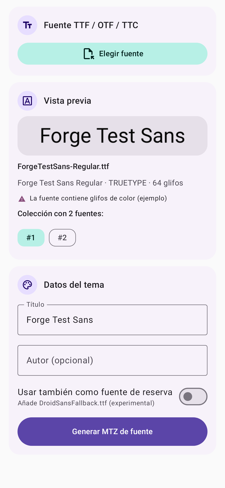
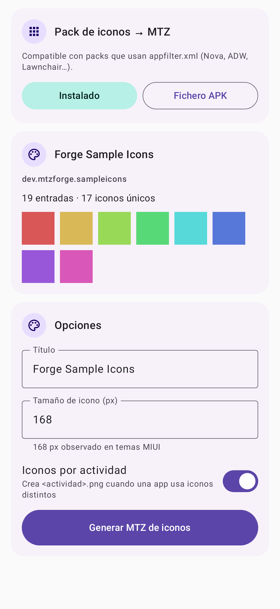
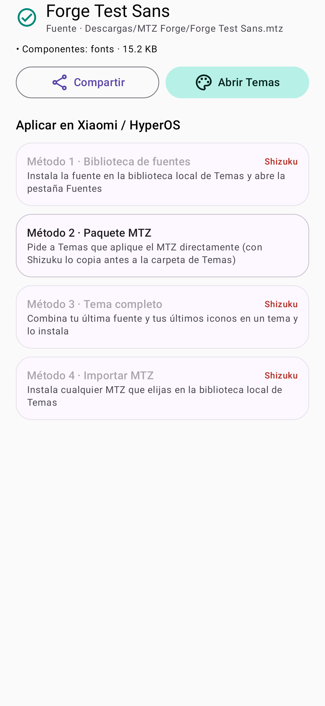
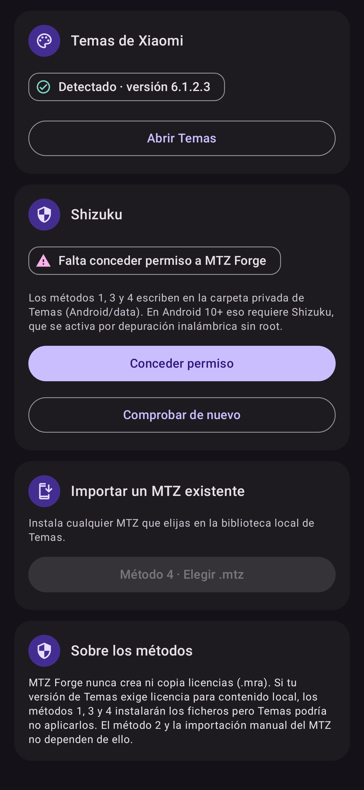

# MTZ Forge

App Android en Kotlin con **Jetpack Compose y Material 3** (colores dinámicos y tema oscuro). Sirve para:

- convertir fuentes **TTF / OTF / TTC → MTZ** (temas de Xiaomi MIUI/HyperOS), de una en una o **una carpeta entera**;
- convertir **packs de iconos APK → MTZ** (instalados o desde fichero; formato `appfilter.xml`);
- exportar a **Descargas/MTZ Forge/**, compartir y abrir **Temas de Xiaomi**;
- aplicar con **4 métodos**, tres de ellos con **Shizuku** (sin root).

| Fuentes | Iconos | Resultado y métodos | Ajustes (oscuro) |
|---|---|---|---|
|  |  |  |  |

> Las capturas se generan en los tests (Robolectric), no en un teléfono.
> ⚠️ **No probado aún en un Xiaomi real.** La lista de comprobaciones pendientes está en `docs/INGENIERIA_INVERSA.md` §7.

## Los 4 métodos de aplicación

| Método | Qué hace | Requiere |
|---|---|---|
| 1 · Biblioteca de fuentes | Escribe la fuente en la biblioteca local de Temas (`.data`: content/meta/preview), cierra Temas y abre el recurso | Shizuku (Android 10+) |
| 2 · Paquete MTZ | Pide a Temas aplicar el MTZ (`ApplyThemeForScreenshot`). Con Shizuku, antes copia el MTZ a la carpeta de Temas | Nada (Shizuku opcional) |
| 3 · Tema completo | Combina tu última fuente y tus últimos iconos en un tema y lo instala en la biblioteca | Shizuku |
| 4 · Importar MTZ | Instala cualquier `.mtz` que elijas en la biblioteca | Shizuku |

**Diferencia con zFont:** MTZ Forge **nunca crea, copia ni descarga licencias** (`.mra`). zFont usa una licencia firmada que lleva dentro de su APK (métodos 1 y 3) o la obtiene de su servidor (método 4); eso no se replica. Si tu versión de Temas exige licencia para contenido local, los métodos 1, 3 y 4 instalarán los ficheros, pero puede que Temas no los aplique.

### Configurar Shizuku (sin root)
1. Instala **Shizuku** (Google Play o GitHub `RikkaApps/Shizuku`).
2. Actívalo con **Depuración inalámbrica** (Android 11+) siguiendo las instrucciones de la propia app.
3. En MTZ Forge → **Ajustes** → **Conceder permiso**.

El servicio Shizuku de MTZ Forge (`FileService`, ejecutado como shell) **solo puede escribir dentro de las carpetas de Temas** y forzar el cierre de Temas. No ejecuta comandos arbitrarios.

## Estructura
```
core/            Kotlin/JVM puro: SFNT, description.xml, MTZ, appfilter→iconos, biblioteca .data (ThemeStore), CLI
app/             App Compose + Material 3, Shizuku (AIDL UserService), tests Robolectric
sample-iconpack/ Pack de iconos de prueba con diseños propios
samples/         MTZ y biblioteca .data de ejemplo generados por los tests
dist/            MtzForge-0.2.0.apk (release minificado, firma debug) y pack de prueba
docs/            Informe del análisis y capturas
```

## Compilar
```sh
# JDK 17+ y Android SDK 35 (local.properties: sdk.dir=...)
./gradlew :core:test :app:testDebugUnitTest     # 31 tests
./gradlew :app:assembleRelease                  # firma debug salvo que definas MTZFORGE_KEYSTORE*
```
GitHub Actions (`.github/workflows/mtzforge.yml`) ejecuta los tests y publica los APK como artefactos. Para firmarlos con tu propia clave, añade los secrets `MTZFORGE_KEYSTORE_BASE64`, `MTZFORGE_KEYSTORE_PASSWORD`, `MTZFORGE_KEY_ALIAS` y `MTZFORGE_KEY_PASSWORD`.

CLI de escritorio:
```sh
./gradlew :core:installDist
core/build/install/core/bin/core font MiFuente.ttf MiFuente.mtz "Mi fuente"
core/build/install/core/bin/core inspect MiFuente.mtz
```
